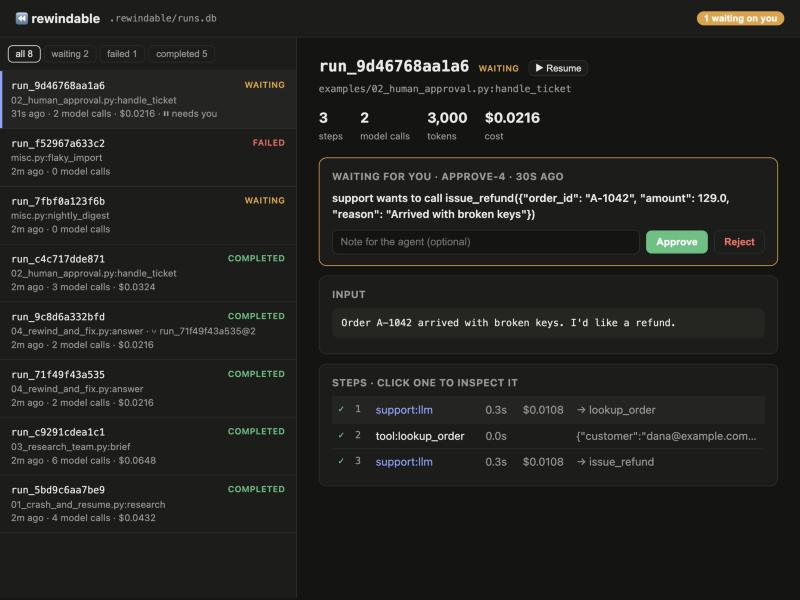

# ⏪ rewindable

**Crash-proof, resumable, rewindable AI agent workflows. In plain Python, on SQLite, with zero dependencies.**

[](https://github.com/milad-ahmd/rewindable/actions/workflows/ci.yml)
[](https://www.python.org/)
[](LICENSE)

Agents fail in boring ways. The process dies at step 37 of 40, and you pay for steps 1–36 again. A tool has a bug, and you re-run the whole conversation to test the fix. An agent is about to send an email or move money, and you want a human to say yes first, maybe hours later.

`rewindable` records every model call, tool call and side effect as a **step in a journal**. Then:

- **Crash → resume.** Completed steps come back from the journal instantly and for free. Only the rest runs.
- **Pause for a human.** `ctx.approve("Refund €129?")` saves the run and lets the process exit. Approve from the CLI tomorrow and it continues from that exact line.
- **Rewind to any step.** Fix the bug, then `rewindable rewind <run> --to 7`. Steps 1–6 replay from the journal and step 7 onward runs with your new code.
- **Fan out safely.** `ctx.parallel(...)` and parallel tool calls each journal on their own. One failing branch never re-runs the others.
- **Sleep for days.** `ctx.sleep(3 * DAY)` saves the run with a wake-up time. `rewindable worker` resumes it on time, even after a reboot.
- **Hard budgets.** `Budget(max_cost_usd=2)` is checked before every model call and counts usage across crashes and resumes.
- **One driver per run.** Leases stop two processes from running the same workflow at once, and runs left behind by crashed processes are picked up automatically.
- **See everything.** `rewindable ui` opens a local web view of every run, step and model conversation, with approve, resume and rewind buttons. `rewindable show <run>` gives the same view in the terminal.



```text
$ rewindable show run_34abbb562f61        # examples/03_research_team.py, offline mode
run_34abbb562f61  completed  examples/03_research_team.py:brief
input: Should we build an open-source durable agent runtime?

✓ 1      lead:llm                        0.3s  $0.0108  → market, tech, risk
✓ 2      lead:tools                      0.6s           3 branches
  ✓ 2.0.1  market:llm                    0.3s  $0.0108  → market_size
  ✓ 2.0.2  tool:market_size              0.0s           {"segment": "AI agent infrastructure", "tam_usd_bn": 4.2, "…
  ✓ 2.0.3  market:llm                    0.3s  $0.0108  Demand is driven by teams moving agents to production. Data…
  ✓ 2.1.1  tech:llm                      0.3s  $0.0108  The hard parts are durability, observability and cost contr…
  ✓ 2.2.1  risk:llm                      0.3s  $0.0108  Main risk: frameworks commoditize fast; differentiate on re…
✓ 3      lead:llm                        0.3s  $0.0108  ## Brief - Demand is driven by teams moving agents to produ…

8 steps · 6 model calls · 9,000 tokens · $0.0648
```

## Try it in 60 seconds (no API key needed)

Every example runs offline with a scripted model, so you can try the whole crash → resume → approve → rewind cycle for free.

```bash
git clone https://github.com/milad-ahmd/rewindable && cd rewindable
pip install -e .

python examples/01_crash_and_resume.py --crash    # 💥 dies before writing the report
rewindable runs                                    # the run is stuck in "running"
rewindable resume <run_id>                         # replayed 9 steps from the journal, executed 1

python examples/02_human_approval.py               # ⏸ pauses before issuing a refund
rewindable ui                                      # approve it in the browser and watch it finish
```

The other examples cover a [research team of sub-agents](examples/03_research_team.py), [rewinding to test a bug fix](examples/04_rewind_and_fix.py), and a [workflow that sleeps for days](examples/05_follow_up_later.py).

To use Claude instead, run `pip install -e ".[anthropic]"`, set `ANTHROPIC_API_KEY`, and add `REWINDABLE_LIVE=1` before any example command.

## The whole API on one screen

```python
from rewindable import Agent, AnthropicModel, Budget, Engine, tool


@tool
def search(query: str, limit: int = 5) -> list[str]:
    """Search the web.

    Args:
        query: What to look for.
    """
    ...


@tool(requires_approval=True)  # a human must approve every call
def send_email(to: str, subject: str, body: str) -> str:
    """Send an email."""
    ...


researcher = Agent("researcher", AnthropicModel("claude-opus-5-5"), tools=[search])
writer = Agent(
    "writer",
    AnthropicModel("claude-opus-5-5"),
    tools=[send_email],
    instructions="Write a crisp brief and email it to the requester.",
)


def brief(ctx, topic: str) -> str:
    sources = ctx.step("pick sources", lambda: ["arxiv", "hn", "blogs"])  # any side effect
    notes = ctx.parallel(
        [lambda c, s=s: researcher.run(c, f"{topic} on {s}").text for s in sources]
    )  # concurrent, journaled
    if not ctx.approve(f"Send a brief built from {len(notes)} notes?"):  # human in the loop
        return "cancelled"
    return writer.run(ctx, "\n".join(notes)).text


result = Engine().run(brief, "durable execution", budget=Budget(max_cost_usd=1.00))
print(result.status, result.output)  # "waiting" until someone runs `rewindable approve …`
```

| Primitive | What it does |
|---|---|
| `ctx.step(name, fn, *args, retries=0)` | Runs `fn` once for this point in the workflow; afterwards it is served from the journal. |
| `ctx.llm(model, messages=…, tools=…)` | A model call as a step, with budget check and token and cost accounting. |
| `ctx.parallel([branch, …])` | Runs `branch(child_ctx)` concurrently; each branch journals its own steps. |
| `ctx.approve(question, timeout=…)` / `ctx.wait_for(signal, timeout=…, default=…)` | Suspends the run until a human or another system answers, optionally with a deadline. |
| `ctx.sleep(seconds)` | A durable timer: short waits sleep in-process, long ones suspend the run until a worker wakes it. |
| `ctx.now()` / `ctx.uuid()` | Time and randomness, recorded so replays see the same values. |
| `current_step().idempotency_key` | Inside a step: a key that stays the same across retries and resumes, for payment and email APIs. |
| `Agent(name, model, tools=…, instructions=…)` | A tool-use loop where every model turn and tool call is a step. |
| `agent.as_tool()` | Lets one agent delegate to another (supervisor and specialist teams). |
| `Engine.run / submit / resume / rewind / signal / approve / work` | Run lifecycle and a worker loop, also available from the CLI. |

## The one rule: same inputs, same steps

Replay works by matching your code's step calls, in order, against the journal. So the workflow body should be **deterministic**. Anything that touches the outside world, costs money, or is random goes through `ctx`:

```python
# ✗ re-runs on every resume, and replays see a different value
started = time.time()
data = requests.get(url).json()

# ✓ recorded once, replayed forever
started = ctx.now()
data = ctx.step("fetch", lambda: requests.get(url).json())
```

If you change the workflow so that step 4 is now a different step, `resume` raises `NonDeterminismError` instead of feeding the wrong cached result to the wrong code. Use `rewind --to 4` to branch from the last step that still matches. [How it works](docs/how-it-works.md) covers the journal, step keys, parallel branches and the exact guarantees.

## CLI

```text
rewindable ui                               local web UI: runs, steps, conversations, approve/resume/rewind
rewindable runs [--status waiting]          list recent runs, with cost
rewindable show RUN [--json]                step tree: timing, tokens, cost, results
rewindable step RUN KEY                     everything recorded for one step (full model output)
rewindable pending                          approvals and signals waiting on a human
rewindable approve RUN KEY [--reject --note "…"]
rewindable signal RUN KEY '{"json": "payload"}'
rewindable resume RUN [--max-cost 5]        continue a crashed, failed or waiting run
rewindable rewind RUN --to STEP [--input '…']
rewindable start app.py:flow --input '…' [--queue]
rewindable worker [--once]                  drive queued runs, due timers, answered approvals, crashed runs
```

Run ids accept unique prefixes. The journal lives in `.rewindable/runs.db`; override it with `--db` or `REWINDABLE_DB`. Because the journal is one SQLite file in WAL mode, any process on the machine can approve, resume or work on a run.

### Running in production

Queue work with `engine.submit(flow, input)` (or `rewindable start … --queue`) and keep one or more `rewindable worker` processes running, for example under systemd or in a container. A worker drives queued runs, wakes timers that are due, resumes runs whose approval has arrived, and takes over runs whose driver crashed (on the same machine immediately, elsewhere once the 30-second lease lapses). Several workers can share one journal safely.

## Models

| Adapter | Install | Notes |
|---|---|---|
| `AnthropicModel("claude-opus-5-5")` | `pip install "rewindable[anthropic]"` | Official SDK. Server-side refusal fallbacks are on by default (`fallbacks=None` turns them off); `effort="low"…"max"`. Built-in price table for cost tracking. |
| `OpenAICompatModel("llama3.2", base_url="http://localhost:11434/v1")` | `pip install "rewindable[openai]"` | Any Chat Completions endpoint: OpenAI, Ollama, vLLM, LM Studio, OpenRouter. |
| `ScriptedModel(fn_or_list)` | built in | Deterministic offline model for tests, demos and CI. |

Any object with `name`, `complete(request) -> response` and `cost(response) -> float` works as a model. See [models.py](src/rewindable/models.py) for the request and response format (Claude Messages API shape).

## How is this different from…

- **Agent frameworks** (LangGraph, CrewAI, AutoGen, the vendor agent SDKs) give you agent abstractions, and some can checkpoint state inside their own graph model. `rewindable` is not a framework you build inside. It is a durability layer for plain Python functions, with a deliberately small agent loop on top. You can wrap calls from other libraries in `ctx.step`.
- **Durable execution engines** (Temporal, DBOS, Restate, Inngest) solved this problem for backend workflows and inspired this project. They are the right choice at scale, but they mean running a server or a database and learning a platform. `rewindable` brings the same journal-and-replay idea down to `pip install` and one SQLite file, with LLM-specific features built in: token and cost accounting, budgets, tool approvals, and rewinding to debug an agent.

## Status and roadmap

This is an alpha. The core semantics are tested (a real crash in a subprocess, resume, suspend, parallel, budget, rewind, leases, timers, the worker and the web UI), but the API may still change. Ideas where help is very welcome:

- [x] A local web UI for the run timeline (`rewindable ui`)
- [x] Durable timers, approval timeouts and a background worker
- [ ] `async` workflows and `asyncio`-native parallel branches
- [ ] Postgres journal backend for multi-machine workers
- [ ] OpenTelemetry export of steps as spans
- [ ] MCP servers as tool sources
- [ ] Step memoization across runs (cache identical tool calls)
- [ ] Streaming model responses into the journal
- [ ] A TypeScript port

## Contributing

Issues, ideas and PRs are welcome; see [CONTRIBUTING.md](CONTRIBUTING.md). The test suite runs in a few seconds and needs no API keys.

## License

[MIT](LICENSE)
